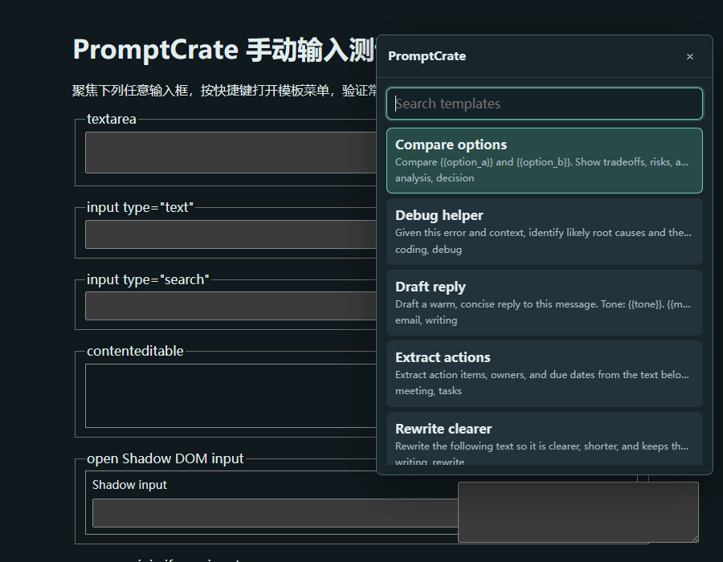
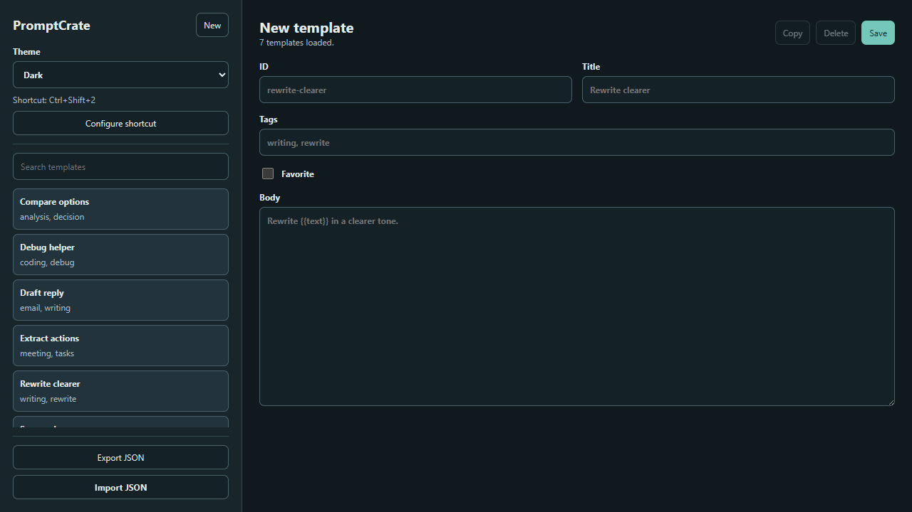

# 菜单搜索与显示

搜索词按空白分开，每个词都要命中模板标题、正文或标签。例如 `rewrite writing` 可同时命中 Rewrite clearer 的标题和 writing 标签。`#writing` 只匹配完整标签，可以与普通搜索词组合。标题前缀和标题包含排在标签、正文命中之前；同等相关度时再按收藏、最近使用和标题排序。普通子串没有命中时，还支持标题字符顺序匹配，例如 `rwt` 可匹配 Rewrite。

菜单打开或模板库刷新时建立搜索索引，不会在每次方向键操作时重新规范化整套文本。搜索框和面板保持原节点，输入时只更新结果；上下键只改变选择和可访问性属性。菜单最多显示前 100 项，并显示总匹配数；通过缩小搜索范围可找到后面的模板。

## 定位与主题

菜单根据打开前保存的输入位置定位：文本框使用元素位置，contenteditable 优先使用保存选区的位置。下方空间不足时翻到上方，并限制在当前 frame 的视口内。滚动、窗口调整和表单高度变化会重新定位；没有可用位置时居中显示。很矮的 iframe 中可以滚动整个面板，避免列表和表单控件被截断。

Options 的 Preferences 可选择 System、Light 或 Dark。System 跟随系统配色变化；手动设置会保存到本地，并同步到已打开的菜单和编辑页。

## 打开失败与可访问性

受限页面等位置无法注入菜单时，工具栏图标显示 `!`，悬停提示提供原因和重试建议；再次成功打开时会清除提示。Options 会显示当前快捷键，未分配时提示使用工具栏图标，并提供 Configure shortcut 入口。

收藏标记有文字标签；变量填写失败时会聚焦出错字段，并通过实时错误提示播报。Enter 换行、Ctrl/Command+Enter 插入和输入法组字行为保持不变。

跨域 iframe 的其他源不在 `activeTab` 的临时授权范围内，因此其中的编辑器可能无法使用。菜单在获得授权的当前 frame 内显示，不跨 frame 转发编辑内容。
