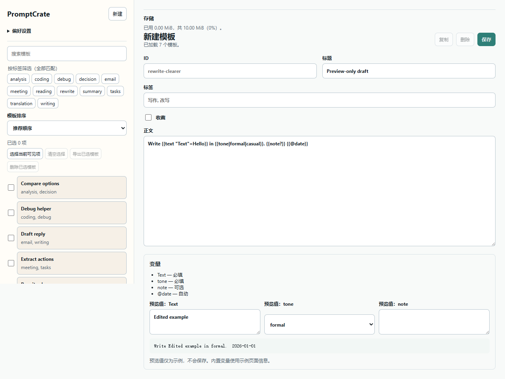
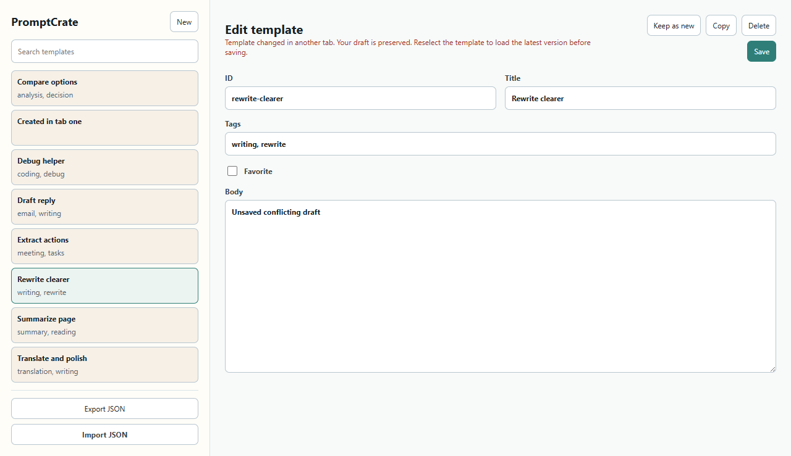

# 模板编辑

在扩展详情页打开 Options，选择已有模板或点击 New 新建模板。正文支持变量，语法见 [模板变量](template-variables.md)。

语言、主题、变量记忆和快捷键设置位于侧栏默认收起的 Preferences（偏好设置）中，展开后即可调整。

- **收藏**：勾选或取消 Favorite 后点击 Save，与正文、标题等修改一起保存。保存前不会改变模板列表中的收藏标记和排序；保存失败时会保留表单内容，修复问题后可重试。
- **自动 ID**：ID 留空时根据标题生成，并自动添加 `-2`、`-3` 等后缀避开已有 ID。同名模板可以分别保存。中文等标题没有英文 slug 时使用时间戳 ID，也会检查冲突。手动填写重复 ID 会提示错误，不会覆盖已有模板。
- **标签**：支持英文逗号 `,`、中文逗号 `，`、顿号 `、`、英文分号 `;` 和中文分号 `；`。保存时会去除标签两侧空格、空标签和重复项。



## 草稿与保存

编辑已有模板或填写新模板后，点击 Save 或按 Ctrl+S（macOS：Command+S）保存。输入法组字期间不会用保存快捷键打断输入。

切换模板、点击 New，或执行会替换当前草稿的操作时，Options 会先确认是否丢弃未保存修改。取消后，当前填写内容保持不变。刷新或离开页面时也会请求浏览器显示离开确认；提示的显示方式由浏览器决定。保存失败时保留草稿，可修复错误后重试。

正文下方显示识别到的变量、必填或可选状态、默认值与选项，以及示例渲染预览。无效变量语法会显示诊断，仍需修正后才能保存。示例值仅用于编辑页预览，不会写入变量记忆；内置变量使用示例内容，不读取 Options 页之外的网页信息。

## 筛选、排序与批量操作

搜索继续支持分词、相关度和 `#标签`。标签筛选器可以同时选中多个标签，结果需要包含所有已选标签，并同时满足搜索条件。

排序可选择相关度、手动顺序、标题或最近修改。手动顺序使用模板库中保存的顺序；清空搜索和标签筛选后，可以拖动模板调整顺序，也可以使用上移、下移按钮。排序保存失败时不会丢失原有顺序。该手动顺序用于 Options 和导出文件，网页菜单仍按搜索相关度、收藏和最近使用等规则排序。

勾选列表中的模板后，可以导出或删除已选模板，也可以选择当前可见项或清空选择。更改搜索和标签筛选后仍保留已选项，因此操作数量可能包含筛选后隐藏的模板。批量删除需要确认，并按每个模板的编辑版本一次性提交；如果有模板已被另一页修改或删除，整个操作会提示冲突，不会只删除一部分。导出已选模板只包含模板数据，不包含变量记忆。

## 导入与导入预览

可以导入 PromptCrate 导出的带版本对象，也可以直接导入模板数组。手写模板至少提供字符串形式的 `title` 和 `body`：

```json
[
  { "title": "改写", "body": "请改写：{{text}}", "tags": ["写作"] }
]
```

缺少的 ID、收藏状态、标签和创建/修改时间会自动补齐；显式提供但类型不正确的字段会报错。自动 ID 会避开文件中已有的 ID，重复的显式 ID 会被拒绝。有效的创建、修改和最近使用时间保持原值。

选择文件后，先查看新增和覆盖数量及每项标题，取消不想导入的项，再执行：

- **Merge**：新增所选模板，并按 ID 更新已有模板；其余模板保留。
- **Overwrite**：用所选模板替换整个现有模板库，未选择的现有模板也会删除；执行前会再次确认。

导入失败时保留预览，便于调整后重试。导入的并发冲突规则见 [模板读写与冲突处理](template-storage.md)。

## 存储用量与损坏备份

Options 显示本地存储的实际用量和配额上限；接近配额时提示导出备份或清理不需要的数据。显示用量不增加扩展权限，也不申请 `unlimitedStorage`。

检测到损坏模板的备份后，可以导出原始备份 JSON，或点击尝试恢复。恢复会提取其中有效的模板，显示跳过数量，再进入普通导入预览；查看和尝试恢复不会直接覆盖当前模板库。损坏数据和历史保留规则见 [模板读写与冲突处理](template-storage.md)。

## 同时打开多个编辑页

保存、复制、删除和导入统一由后台排队处理，并按最新模板数据执行。修改不同模板时会保留另一页的新增和修改；自动 ID 也会按后台最新数据去重。

另一页更新当前模板时，未修改的表单会自动刷新；如果已有草稿，会保留填写内容并显示冲突提示，拒绝覆盖较新的版本。可以重新选择模板加载最新内容，或点击 Keep as new 保留为新模板草稿，再点击 Save 保存。当前模板被另一页删除时，也可以保留为新模板，不会在普通 Save 中悄悄恢复已删除的旧记录。



网页插入模板产生的最近使用记录只改变使用时间，不改变编辑时间，也不会覆盖编辑页草稿。插入成功后菜单立即关闭；使用时间记录失败不会要求重新插入。
