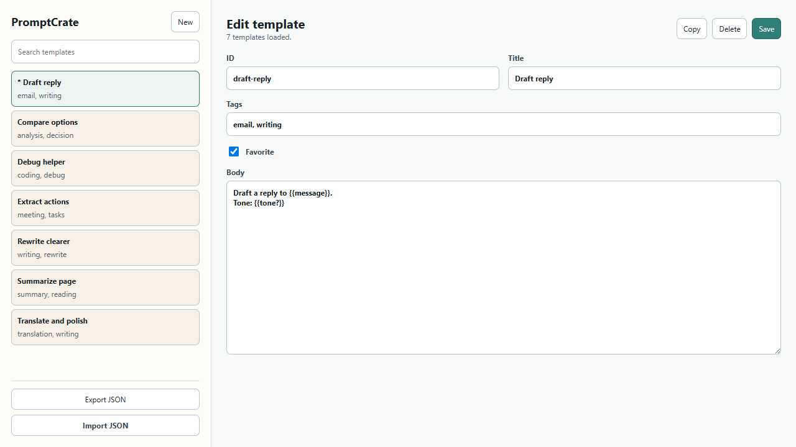

# 模板编辑

在扩展详情页打开 Options，选择已有模板或点击 New 新建模板。正文支持变量，语法见 [模板变量](template-variables.md)。

- **收藏**：勾选或取消 Favorite 后点击 Save，与正文、标题等修改一起保存。保存前不会改变模板列表中的收藏标记和排序；保存失败时会保留表单内容，修复问题后可重试。
- **自动 ID**：ID 留空时根据标题生成，并自动添加 `-2`、`-3` 等后缀避开已有 ID。同名模板可以分别保存。中文等标题没有英文 slug 时使用时间戳 ID，也会检查冲突。手动填写重复 ID 会提示错误，不会覆盖已有模板。
- **标签**：支持英文逗号 `,`、中文逗号 `，`、顿号 `、`、英文分号 `;` 和中文分号 `；`。保存时会去除标签两侧空格、空标签和重复项。

## 同时打开多个编辑页

保存、复制、删除和导入统一由后台排队处理，并按最新模板数据执行。修改不同模板时会保留另一页的新增和修改；自动 ID 也会按后台最新数据去重。

另一页更新当前模板时，未修改的表单会自动刷新；如果已有草稿，会保留填写内容并显示冲突提示，拒绝覆盖较新的版本。可以重新选择模板加载最新内容，或点击 Keep as new 保留为新模板草稿，再点击 Save 保存。当前模板被另一页删除时，也可以保留为新模板，不会在普通 Save 中悄悄恢复已删除的旧记录。

网页插入模板产生的最近使用记录只改变使用时间，不改变编辑时间，也不会覆盖编辑页草稿。插入成功后菜单立即关闭；使用时间记录失败不会要求重新插入。
