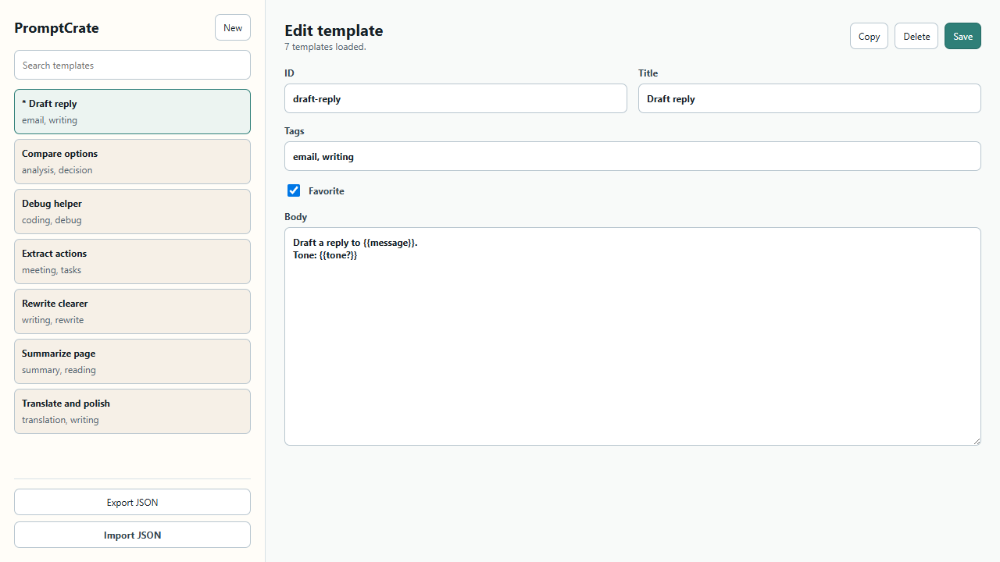

# 模板编辑

在扩展详情页打开 Options，选择已有模板或点击 New 新建模板。正文支持变量，语法见 [模板变量](template-variables.md)。

- **收藏**：勾选或取消 Favorite 后点击 Save，与正文、标题等修改一起保存。保存前不会改变模板列表中的收藏标记和排序；保存失败时会保留表单内容，修复问题后可重试。
- **自动 ID**：ID 留空时根据标题生成，并自动添加 `-2`、`-3` 等后缀避开已有 ID。同名模板可以分别保存。中文等标题没有英文 slug 时使用时间戳 ID，也会检查冲突。手动填写重复 ID 会提示错误，不会覆盖已有模板。
- **标签**：支持英文逗号 `,`、中文逗号 `，`、顿号 `、`、英文分号 `;` 和中文分号 `；`。保存时会去除标签两侧空格、空标签和重复项。

