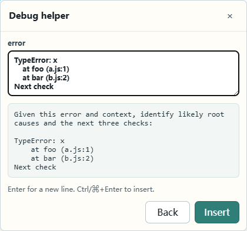

# 模板变量

模板正文支持 `{{变量名}}`（必填）和 `{{变量名?}}`（可选）。变量名可以使用中文、其他 Unicode 字母、数字、下划线、空格和连字符。同名变量只填写一次；只要任何一处是必填，整个字段就按必填处理。

变量输入支持多行，粘贴的段落和报错堆栈会保留换行。按 Enter 换行，点击 Insert 或按 Ctrl+Enter / Command+Enter 插入。变量记忆默认关闭；只有在 Options 主动开启后才在本机保存填写值。

预览和插入使用相同的规则：可选变量未填时替换为空字符串；必填变量未填或只有空白时，预览保留占位符，插入会要求补齐。已填写内容的空白和换行保持原样。

## 默认值、下拉选项与显示名

| 模板语法 | 填写方式 |
| --- | --- |
| `{{tone=friendly}}` | 预填 `friendly`，仍可编辑 |
| `{{tone|formal|casual|friendly}}` | 下拉选择，必填时默认选第一项 |
| `{{tone?|formal|casual}}` | 可选下拉，默认留空 |
| `{{text "要改写的文本"}}` | 字段显示中文名称，变量名仍为 `text` |
| `{{tone "回复语气"=friendly}}` | 显示名与默认值组合 |

显示名使用 JSON 双引号字符串，可用 `\"` 表示引号。`=` 后的全部内容是默认值；`|` 后按竖线分隔选项，选项会去除两端空白并去重。同名变量共享一个字段；重复定义的默认值、选项或显示名必须一致，否则保存时提示冲突。未填写时使用默认值，主动清空必填项仍需补齐。变量值不会作为新模板继续解析。

## 内置变量

| 变量 | 来源 |
| --- | --- |
| `{{@date}}` | 选择模板时的本地日期，`YYYY-MM-DD` |
| `{{@time}}` | 同一时刻的本地时间，`HH:mm` |
| `{{@url}}` | 当前 frame 的 URL |
| `{{@title}}` | 当前 frame 的页面标题 |
| `{{@selection}}` | 打开菜单前保存的输入框或可编辑区域选区，无选区时为空 |

内置变量自动填写，不显示输入控件、不支持默认值或枚举，也不写入变量记忆。只在用户选择明确引用它们的模板时读取相应信息，不读取页面正文。预览与插入共用该次选择时的快照。

## 记住上次输入

在 Options 的“记住变量值”中主动开启后，成功插入的普通变量按模板和变量名保存在 `chrome.storage.local`，仅在本机使用。再次打开时优先填入仍有效的上次值，再回退到模板默认值。模板身份和枚举选项变化后，不兼容的缓存会被丢弃。

“清除已记住的值”保留开启状态并清空缓存；关闭此功能会同时清空缓存。清空后，已经打开的表单仍保留当前草稿；若保持开启并再次插入，会重新保存这些值。模板导入导出不包含记忆值。

## 在正文中保留双花括号

如果正文需要原样包含 GitHub Actions、Jinja、Vue 或 Handlebars 的表达式，在开头的 `{{` 前加一个反斜杠。反斜杠会在预览和插入时去掉，该表达式不会成为变量。

| 模板正文 | 插入结果 |
| --- | --- |
| `Deploy $\{{ github.sha }}` | `Deploy ${{ github.sha }}` |
| `Hello \{{ user.name }}` | `Hello {{ user.name }}` |
| `\{{name}}` | `{{name}}`，不弹出变量输入 |
| `\{{ {"key": "value"} }}` | `{{ {"key": "value"} }}` |
| `\{{ "{{first}} {{second}}" }}` | `{{ "{{first}} {{second}}" }}`，内部不再提取变量 |
| `{{name}}: \{{ user.name }}`，name 填 Ada | `Ada: {{ user.name }}` |

每个紧贴 `{{` 的转义反斜杠只移除一个，其他位置的反斜杠保持原样。变量值中的 `{{...}}` 不会再次解析。JSON 导入文件需要遵循 JSON 字符串规则，用 `\\` 表示一个反斜杠。

转义表达式内的 `{{` / `}}` 按成对嵌套处理；内部的单个花括号和换行保持原样。如果转义表达式没有闭合，保留从反斜杠开始的剩余正文，不提取其中的变量。

未转义且不合法的变量名仍会在保存时提示错误，例如 `{{ user.name }}`；请按上表转义。空名字的 `{{ }}`、`{{?}}` 作为字面量保留。
