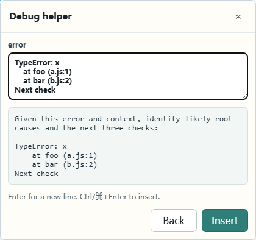

# 模板变量

模板正文支持 `{{变量名}}`（必填）和 `{{变量名?}}`（可选）。变量名可以使用中文、其他 Unicode 字母、数字、下划线、空格和连字符。同名变量只填写一次；只要任何一处是必填，整个字段就按必填处理。

变量输入支持多行，粘贴的段落和报错堆栈会保留换行。按 Enter 换行，点击 Insert 或按 Ctrl+Enter / Command+Enter 插入。变量值仅用于本次插入，不单独保存。

预览和插入使用相同的规则：可选变量未填时替换为空字符串；必填变量未填或只有空白时，预览保留占位符，插入会要求补齐。已填写内容的空白和换行保持原样。

## 在正文中保留双花括号

如果正文需要原样包含 GitHub Actions、Jinja、Vue 或 Handlebars 的表达式，在开头的 `{{` 前加一个反斜杠。反斜杠会在预览和插入时去掉，该表达式不会成为变量。

| 模板正文 | 插入结果 |
| --- | --- |
| `Deploy $\{{ github.sha }}` | `Deploy ${{ github.sha }}` |
| `Hello \{{ user.name }}` | `Hello {{ user.name }}` |
| `\{{name}}` | `{{name}}`，不弹出变量输入 |
| `{{name}}: \{{ user.name }}`，name 填 Ada | `Ada: {{ user.name }}` |

每个紧贴 `{{` 的转义反斜杠只移除一个，其他位置的反斜杠保持原样。变量值中的 `{{...}}` 不会再次解析。JSON 导入文件需要遵循 JSON 字符串规则，用 `\\` 表示一个反斜杠。

未转义且不合法的变量名仍会在保存时提示错误，例如 `{{ user.name }}`；请按上表转义。空名字的 `{{ }}`、`{{?}}` 作为字面量保留。
